# HFX3D Benchmark

<div align="center">

### From Geometry to Function: A Multi-Task LiDAR Benchmark Dataset for Semantic and Functional Parsing of Urban Facades

**WACV 2027** · IEEE/CVF Winter Conference on Applications of Computer Vision

Abdiaziz Muse¹ · Tooba Javed¹ · Tao Pu² · Jiju Poovvancheri¹ · Dong Chen²

<sub>¹ Saint Mary's University, Halifax, Canada · ² Nanjing Forestry University, Nanjing, China</sub>

<br>

A benchmark for **semantic segmentation, instance segmentation, and functional-attribute prediction** of urban building facade LiDAR point clouds.<br>
**26 buildings · ~492 M points · 12 semantic classes · 4 seasons · 5 neighbourhoods**<br>
Halifax, Nova Scotia — ZEB Horizon handheld LiDAR

<sub>Semantic, instance, and functional-attribute baselines are reported below.</sub>

<br>

[**🌐 Project Page**](https://jijup.github.io/hfx3d-benchmark/)

<br>

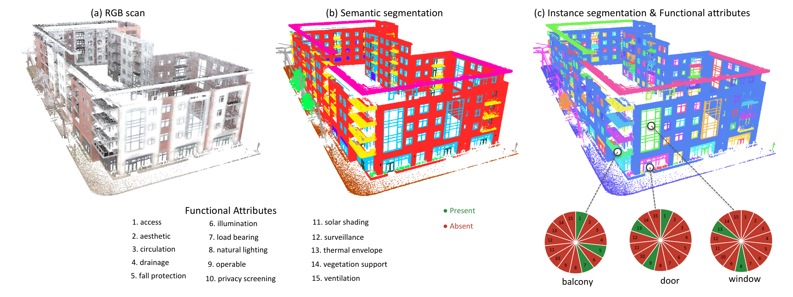

<sub>From a raw RGB LiDAR scan to semantic and instance segmentation, and per-instance functional attributes</sub>

<br>


</div>

---

<div align="center">

[Dataset](#dataset) · [Download](#download) · [Tasks](#tasks) · [Benchmark](#benchmark-results) · [Reproducing](#reproducing-results) · [Annotation](#annotation-pipeline) · [Citation](#citation)

</div>

---

## Walkthroughs

Full-building point cloud fly-through animations, in **semantic** and **instance** colours. Click **MP4** for the full-quality version.

<div align="center">
<table>
  <tr>
    <td colspan="2" align="center"><sub><b>Semantic colours</b> — 12 classes as in the legend above</sub></td>
  </tr>
  <tr>
    <td align="center" width="50%">
      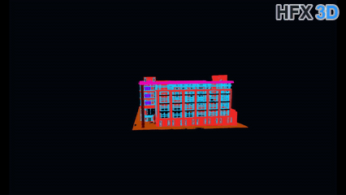
      <br><sub><b>BLD004</b> &nbsp;·&nbsp; <a href="assets/hfx004.mp4">↓ MP4</a></sub>
    </td>
    <td align="center" width="50%">
      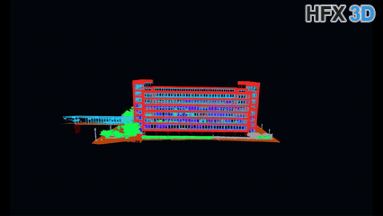
      <br><sub><b>BLD010</b> &nbsp;·&nbsp; <a href="assets/hfx010.mp4">↓ MP4</a></sub>
    </td>
  </tr>
  <tr>
    <td colspan="2" align="center"><sub><b>Instance colours</b> — each object a distinct colour</sub></td>
  </tr>
  <tr>
    <td align="center" width="50%">
      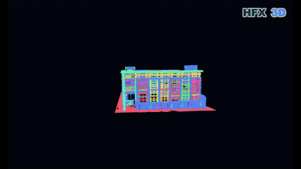
      <br><sub><b>BLD004</b> &nbsp;·&nbsp; <a href="assets/hfx004_instance.mp4">↓ MP4</a></sub>
    </td>
    <td align="center" width="50%">
      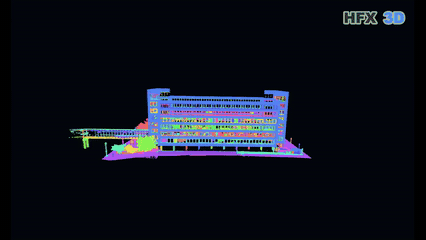
      <br><sub><b>BLD010</b> &nbsp;·&nbsp; <a href="assets/hfx010_instance.mp4">↓ MP4</a></sub>
    </td>
  </tr>
</table>
</div>

---

## Dataset

The dataset consists of 26 Halifax, NS buildings scanned with a ZEB Horizon handheld LiDAR, split at the building level: **18 train / 4 val / 4 test**. Each building is one LAS file; each point carries 7 attributes: `[x, y, z, r, g, b, intensity]`.

**Capture diversity:**
- **Seasons & lighting** — 6–8 months, all 4 seasons, day & night, snow/fog/sun
- **Colour** — GeoSLAM ZEB Vision (4K panoramic + dual-fisheye) fused to per-point RGB
- **Coverage** — 5 urban neighbourhoods (commercial, residential, institutional, waterfront); 2–20 floors

| Property | Value |
|----------|-------|
| Buildings | 26 |
| Total points | ~492 M |
| Classes | 12 |
| Split | 18 train / 4 val / 4 test (343.7M / 68.4M / 79.7M pts) |
| Coordinates | Mean-centred per building, metric scale preserved |
| RGB | \[0, 1\] (raw 16-bit ÷ 65 535) |
| Intensity | \[0, 1\] (p1/p99 from training split) |

<br>

<div align="center">
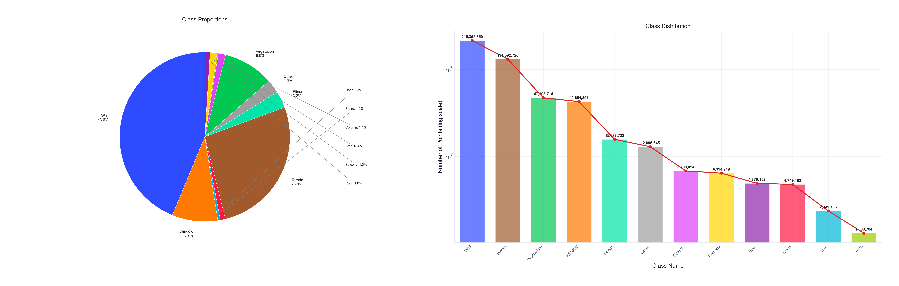
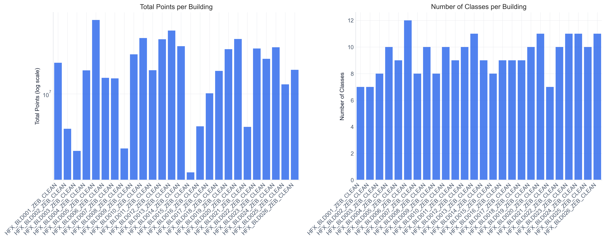
</div>

<br>

<div align="center">
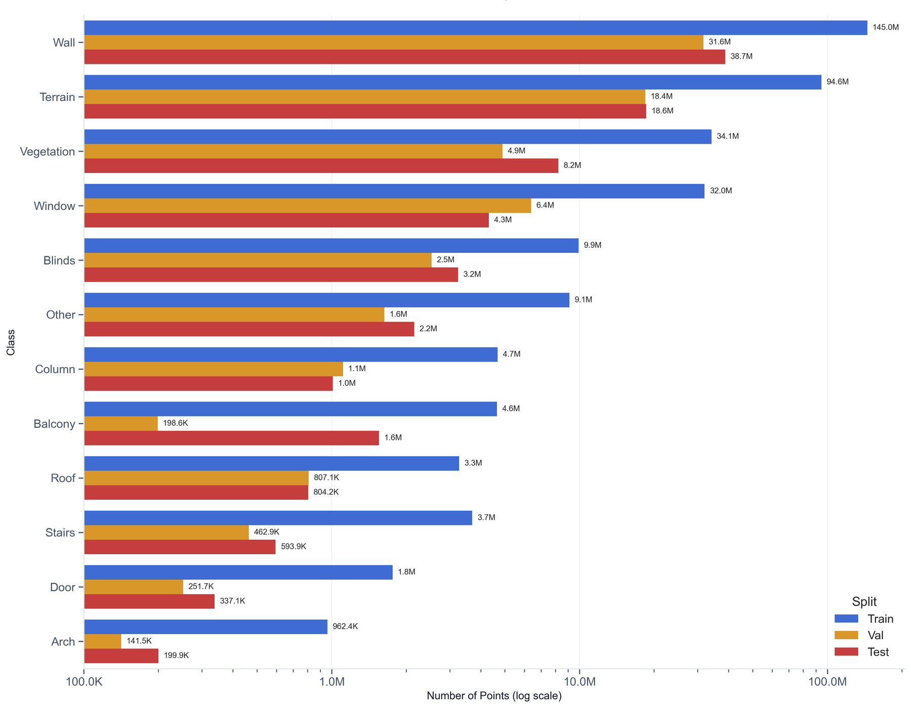
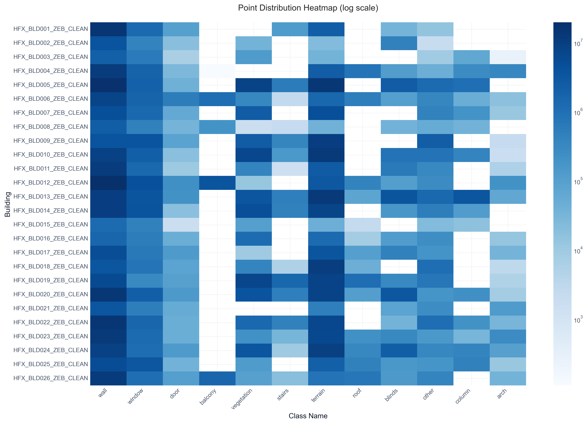
</div>

<br>

<br>

<div align="center">
<sub><b>Environmental diversity</b> — across seasons and lighting conditions</sub>
<table>
  <tr>
    <td align="center">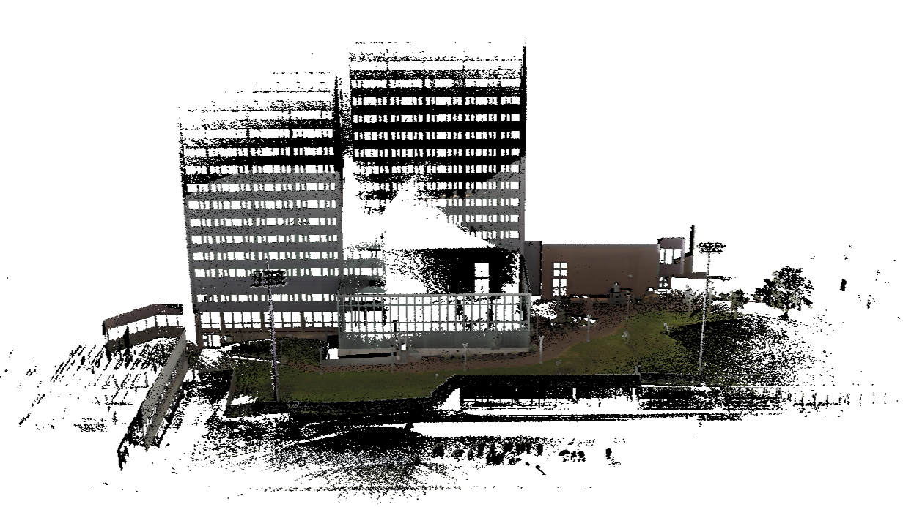<br><sub>Spring</sub></td>
    <td align="center">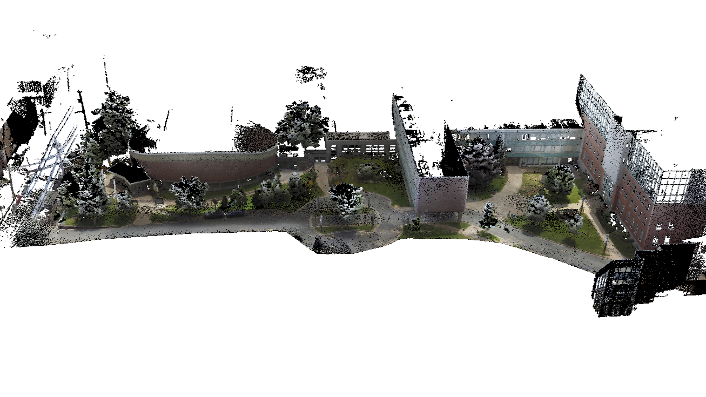<br><sub>Summer</sub></td>
    <td align="center">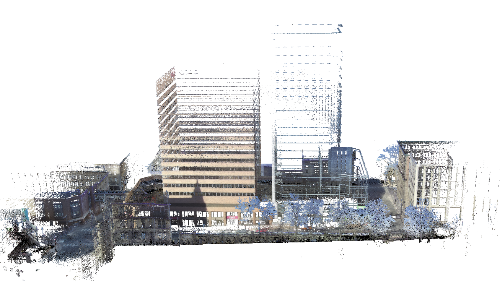<br><sub>Fall</sub></td>
  </tr>
  <tr>
    <td align="center">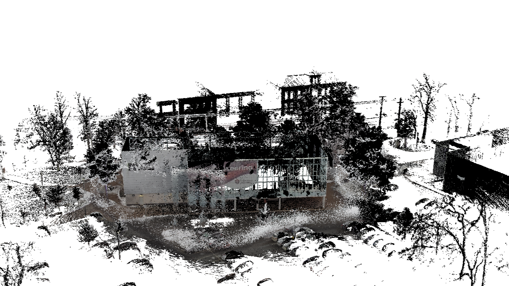<br><sub>Winter (snow)</sub></td>
    <td align="center">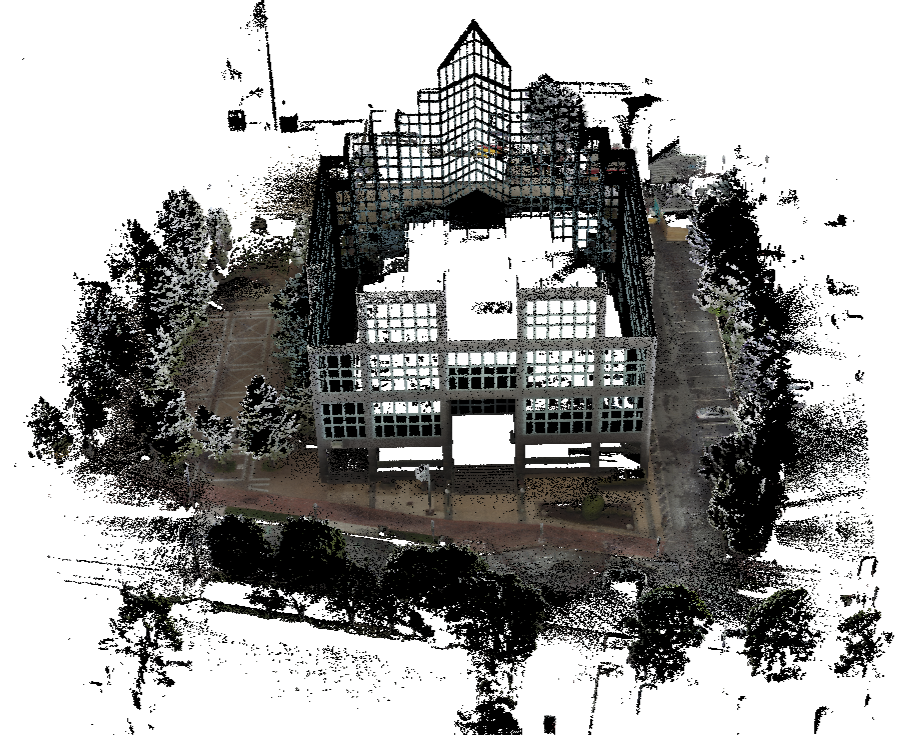<br><sub>Daytime</sub></td>
    <td align="center">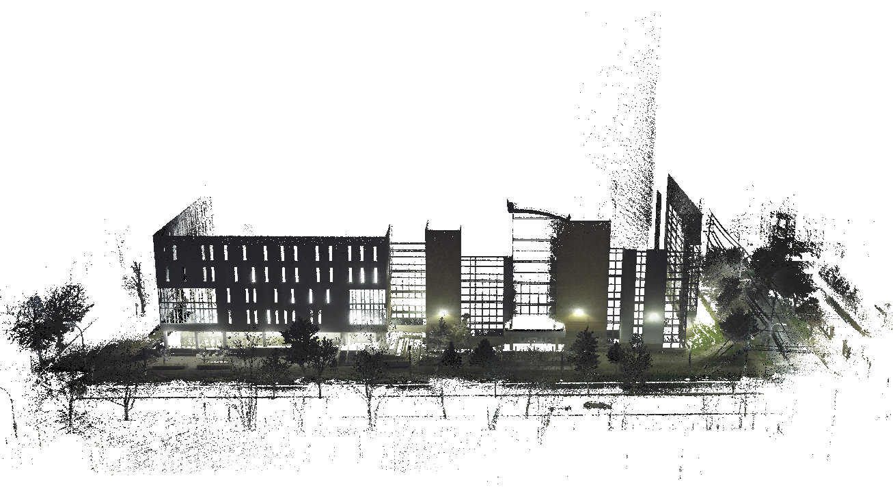<br><sub>Night-time</sub></td>
  </tr>
</table>
</div>

<br>

- Building index and naming → [`docs/HFX3D_README.md`](docs/HFX3D_README.md)
- 12-class taxonomy and imbalance notes → [`docs/LABEL_TAXONOMY.md`](docs/LABEL_TAXONOMY.md)
- Split assignments and point counts → [`data/splits/SPLITS.md`](data/splits/SPLITS.md)

---

## Download

📦 **Coming soon.** The dataset (per-building HDF5 files with the official normalization) will be released on **[Hugging Face](https://huggingface.co/)**. Until then, contact the authors (see [Contact](#contact)) for access.

```bash
# once released (example):
# huggingface-cli download <org>/HFX3D --repo-type dataset --local-dir HFX3D_Splits
export HFX3D_DATA_ROOT=/path/to/HFX3D_Splits
```

---

## Tasks

HFX3D targets three tasks of increasing difficulty on the same point clouds:

| Task | Description |
|------|-------------|
| **Semantic segmentation** | Per-point label over 12 facade classes |
| **Instance segmentation** | Separating discrete/repeated facade elements (e.g. individual windows) |
| **Functional-attribute prediction** | Per-instance functional attribute tagging |

Instance and functional labels are produced with the semi-automatic annotation pipeline in [`scripts/`](scripts/README.md) (geometry-based clustering + CloudCompare review).

---

## Benchmark Results

### Semantic Segmentation

**Protocol:** 200 epochs, unweighted cross-entropy, 7-channel input (xyz+rgb+intensity), full-scene 100%-coverage inference (possibility-guided KNN-crop voting). Checkpoint selected on val set.

#### Summary

| Model | OA | mIoU | mP | mR | mF1 |
|-------|:---:|:----:|:--:|:--:|:---:|
| KPConv | 85.0% | **47.69%** | 65.1% | 52.3% | 55.9% |
| PointNet++ (SSG) | 78.5% | **29.19%** | 39.1% | 34.8% | 35.2% |
| PTv3 (Point Transformer V3) | 74.8% | **28.18%** | 45.1% | 33.7% | 35.7% |
| PointNet | 75.6% | **26.30%** | 39.8% | 32.9% | 33.3% |
| PTv2 (Point Transformer V2) | 77.9% | **20.65%** | 33.0% | 27.5% | 25.0% |
| RandLA-Net | 72.6% | **16.94%** | 24.9% | 21.4% | 21.4% |
| DGCNN | 71.9% | **15.37%** | 25.7% | 18.9% | 18.9% |

#### Per-class IoU

| Class | KPConv | PointNet++ | PTv3 | PointNet | PTv2 | RandLA-Net | DGCNN |
|-------|:------:|:----------:|:----:|:--------:|:----:|:----------:|:-----:|
| wall | **80.56%** | 72.47% | 65.98% | 69.31% | 77.74% | 67.98% | 63.53% |
| window | **42.19%** | 21.99% | 6.62% | 20.45% | 29.14% | 3.01% | 4.21% |
| door | **19.86%** | 0.00% | 0.00% | 1.16% | 0.00% | 0.00% | 0.00% |
| balcony | 25.40% | 0.00% | **36.65%** | 0.00% | 0.05% | 0.00% | 0.00% |
| vegetation | **93.91%** | 84.88% | 83.41% | 81.27% | 58.81% | 30.05% | 33.25% |
| stairs | **83.50%** | 63.73% | 0.00% | 41.14% | 0.00% | 0.00% | 0.00% |
| terrain | **91.64%** | 83.57% | 83.91% | 73.46% | 80.16% | 82.04% | 83.10% |
| roof | 0.00% | 0.02% | **22.89%** | 0.13% | 0.00% | 20.14% | 0.00% |
| blinds | **42.74%** | 6.39% | 0.00% | 4.27% | 0.00% | 0.00% | 0.00% |
| other | **55.87%** | 16.25% | 28.20% | 22.19% | 1.88% | 0.00% | 0.34% |
| column | **36.54%** | 1.02% | 10.44% | 2.20% | 0.00% | 0.00% | 0.00% |
| arch | **0.02%** | 0.00% | 0.00% | 0.00% | 0.00% | 0.00% | 0.00% |
| **mIoU** | **47.69%** | **29.19%** | **28.18%** | **26.30%** | **20.65%** | **16.94%** | **15.37%** |

#### Qualitative Results

Per-building predictions vs. ground truth visualizations across all seven baseline models are on the [**project page qualitative gallery**](https://jijup.github.io/hfx3d-benchmark/#qualitative).

### Instance Segmentation

Element-level segmentation over the eight countable "thing" classes (AP averaged over IoU 0.50–0.95, plus AP50/AP25; minimum instance size 200 points). Ground-truth instance labels come from the annotation pipeline in [`scripts/`](scripts/README.md) (planar region-growing + DBSCAN, then CloudCompare review).

**Learned methods** — trained end-to-end from raw points, no semantics supplied:

| Method | mAP | AP50 | AP25 |
|--------|:---:|:----:|:----:|
| SoftGroup | **0.0030** | **0.0060** | **0.0270** |
| PointGroup | 0.0003 | 0.0013 | 0.0215 |
| ISBNet | 0.0000 | 0.0000 | 0.0093 |

**Geometry-based clustering given ground-truth semantics** — an oracle ceiling for separation once each point's class is known:

| Method | mAP | AP50 | AP25 |
|--------|:---:|:----:|:----:|
| DBSCAN | **0.2247** | **0.3906** | **0.4749** |
| HDBSCAN | 0.0700 | 0.1226 | 0.1928 |
| MeanShift | 0.0607 | 0.0652 | 0.1206 |
| KMeans | 0.0166 | 0.0564 | 0.1498 |

Learned methods struggle on repetitive facade elements (best 0.006 AP50); with ground-truth semantics, DBSCAN clustering reaches 0.39 AP50.

### Functional-Attribute Prediction

Each instance carries a **15-dimensional multi-label functional attribute vector**. Attributes are auto-suggested from a semantic→function ontology (IFC 4.3 + Getty AAT), refined with instance geometry and graph context (log-odds fusion), then human-validated. Pipeline: [`scripts/functional_attributes/`](scripts/functional_attributes/).

**Attributes (15):** load-bearing (LB), thermal envelope (TE), access (AC), operable (OP), solar shading (SS), ventilation (VE), natural lighting (NL), drainage (DR), fall protection (FP), circulation (CI), privacy screening (PS), vegetation support (VS), aesthetic (AE), illumination (IL), surveillance (SU).

**Semantic → candidate attributes:**

| Class | Candidates | Class | Candidates |
|-------|------------|-------|------------|
| wall | LB, TE, VS | window | TE, OP, SS, VE, NL |
| roof | LB, TE, DR, FP | door | AC, OP, TE |
| column | LB, AE | blinds | SS, OP, PS |
| arch | LB, AE, IL, SU | balcony | LB, AC, VS, FP |
| terrain | CI | stairs | CI, FP |
| vegetation | AE | other | (varies) |

**Evidence ablation** — macro-F1 / exact-set-match, on all test instances and the class-ambiguous subset (S = semantic prior, G = geometry, C = context):

| Evidence | mF1 (All) | ESM (All) | mF1 (Amb) | ESM (Amb) |
|----------|:---------:|:---------:|:---------:|:---------:|
| S only | 0.6367 | **0.6905** | 0.4808 | 0.5378 |
| G only | **0.8071** | 0.5880 | **0.7039** | 0.5280 |
| C only | 0.7449 | 0.5420 | 0.6746 | 0.4958 |
| S + G | 0.7458 | 0.6888 | 0.5928 | **0.5434** |
| S + C | 0.7145 | 0.6676 | 0.6072 | 0.5224 |
| S + G + C | 0.7691 | 0.6799 | 0.6606 | **0.5434** |

Evaluated on 1,131 test instances (714 in the ambiguous subset, where semantic class alone doesn't fix the attributes — e.g. operable vs fixed windows, structural vs decorative columns).

---

## Reproducing Results

Full setup instructions (framework cloning, file placement, cluster config) are in [`docs/REPRODUCTION.md`](docs/REPRODUCTION.md).

```bash
# Submit all baseline training jobs at once
bash slurm/run_all_baselines.sh

# Or individually
sbatch slurm/kpconv/submit_kpconv.sh    # KPConv      (~24h, 200 epochs)
sbatch slurm/pointnet2/submit_pn2.sh    # PointNet++  (~24h, 200 epochs)
sbatch slurm/pointnet2/submit_pn.sh     # PointNet    (~24h, 200 epochs)
sbatch slurm/pointcept/submit_ptv2.sh   # PTv2        (~24h, 200 epochs)
sbatch slurm/pointcept/submit_ptv3.sh   # PTv3        (~24h, 200 epochs)
sbatch slurm/dgcnn/submit_dgcnn.sh      # DGCNN       (~15 min, 200 epochs)
sbatch slurm/randlanet/submit_randla.sh # RandLA-Net  (~24h, 200 epochs)
```

Set `HFX3D_DATA_ROOT` to your `HFX3D_Splits/` path before training; all dataset loaders read this env var.

### Framework Repos

| Model | Upstream |
|-------|----------|
| PTv2 / PTv3 | [Pointcept/Pointcept](https://github.com/Pointcept/Pointcept) |
| DGCNN | [AnTao97/dgcnn.pytorch](https://github.com/AnTao97/dgcnn.pytorch) |
| RandLA-Net | [QingyongHu/RandLA-Net](https://github.com/QingyongHu/RandLA-Net) |
| PointNet / PointNet++ | [yanx27/Pointnet_Pointnet2_pytorch](https://github.com/yanx27/Pointnet_Pointnet2_pytorch) |
| KPConv | [HuguesTHOMAS/KPConv-PyTorch](https://github.com/HuguesTHOMAS/KPConv-PyTorch) |

---

## Preprocessing

The distributed LAS files are already cleaned and labelled. To produce HDF5 training data:

```bash
# input_dir must contain train/ val/ test/ subdirs with .las files
python preprocessing/las_to_hdf5.py <input_dir> <output_dir>
```

`las_to_hdf5.py` is two-pass: computes intensity p1/p99 from the training split first, then normalises all splits with those stats. `preprocess.py` is included for reference if adapting to a new raw dataset.

---

## Annotation Pipeline

The semi-automatic pipeline used to add **instance IDs** and to **review/correct** class labels lives in [`scripts/`](scripts/README.md). It clusters points into objects (planar region-growing + DBSCAN), exports an editable PLY for CloudCompare, and imports hand edits back into the HDF5 — the HDF5 is the source of truth, the PLY is a disposable view.

```bash
python scripts/generate_instances.py --only BLD003 --eps 0.20   # draft instances → editable PLY
python scripts/import_instances.py <edited.ply> --root Output    # pull CloudCompare edits back
python scripts/review_metrics.py --root Output                   # original-vs-reviewed report
```

Full workflow, options, and the CloudCompare guide are in [`scripts/README.md`](scripts/README.md).

### Annotation & Quality Control

- **Two-round cross-review** — one primary annotator per building; reviewers never review their own buildings; disagreements settled by majority vote.
- **Inter-annotator agreement** — Cohen's κ per building: round 1 mean **0.44** → round 2 mean **0.99** after corrections.
- **Instance refinement** — DBSCAN candidates hand-refined, **8,586 → 6,418** instances (−25.3%), mostly merging over-segmentation.

---

## Infrastructure

- **Cluster:** [Alliance Canada](https://docs.alliancecan.ca/wiki/Tamia) — `tamia.alliancecan.ca`
- **GPUs:** NVIDIA H100 · a full 4-GPU node per job (tamia policy); PTv2/PTv3 use 2 GPUs, all other models 1
- **Container:** Apptainer SIF (PyTorch 2.4.1, CUDA 12.1)
- **Scheduler:** SLURM

---

## Repository Structure

```
hfx3d-benchmark/
├── assets/              # figures, walkthroughs, and other media
├── models/
│   ├── pointcept/       # HFX3DDataset class + PTv2/PTv3 configs
│   ├── dgcnn/           # training, eval, and full-scene inference scripts
│   ├── randlanet/       # dataset adapter, model, training, and eval scripts
│   ├── pointnet2/       # dataset loader + training/eval scripts (PointNet & PointNet++)
│   └── kpconv/          # dataset adapter + training/eval scripts
├── slurm/
│   ├── pointcept/       # PTv2/PTv3 SLURM scripts
│   ├── dgcnn/           # DGCNN SLURM script
│   ├── randlanet/       # RandLA-Net SLURM script + eval
│   ├── pointnet2/       # PointNet/PointNet++ SLURM scripts
│   ├── kpconv/          # KPConv SLURM script
│   ├── run_all_baselines.sh
│   └── evaluate_all_baselines.sh
├── scripts/             # instance + classification annotation pipeline (see scripts/README.md)
├── preprocessing/
│   ├── preprocess.py    # strip label-0 points, shift labels
│   ├── las_to_hdf5.py   # LAS → HDF5 with official normalization
│   └── analyse_dataset.py
├── configs/
│   ├── palette.py       # single source of truth for all class/split colours
│   ├── label_map.json
│   └── scalar_fields.xml
├── data/splits/         # train.txt / val.txt / test.txt
└── docs/
    ├── REPRODUCTION.md
    ├── HFX3D_README.md  # building index + naming convention
    └── LABEL_TAXONOMY.md
```

---

## Acknowledgements

<div align="center"></div>

<br>

This work was supported by the [Natural Sciences and Engineering Research Council of Canada (NSERC)](https://www.nserc-crsng.gc.ca/) and the [Canada Foundation for Innovation (CFI)](https://www.innovation.ca/). Computational resources were provided by the [Digital Research Alliance of Canada](https://alliancecan.ca/). We gratefully acknowledge [Saint Mary's University](https://www.smu.ca/) for institutional support. We thank the building owners and facility managers across Halifax for generously granting scanning access to their properties. The quality of the HFX3D annotations is owed to the dedication of our collection, curation and labelling team: Tooba Javed, Prachi Kudeshia, Jack Greenlaw, Avery Cao, and Khushal Das.

---

## Citation

If you use HFX3D in your research, please cite:

```bibtex
@inproceedings{hfx3d2027,
  title     = {From Geometry to Function: A Multi-Task {LiDAR} Benchmark Dataset
               for Semantic and Functional Parsing of Urban Facades},
  author    = {Muse, Abdiaziz and Javed, Tooba and Pu, Tao and
               Poovvancheri, Jiju and Chen, Dong},
  booktitle = {Proceedings of the IEEE/CVF Winter Conference on Applications
               of Computer Vision (WACV)},
  year      = {2027},
}
```

---

## License

| Component | License |
|-----------|---------|
| Dataset (point clouds + labels) | [CC BY 4.0](LICENSE-DATA) |
| Benchmark code | [MIT](LICENSE) |

---

## Contact

| | |
|--|--|
| Abdiaziz Muse | [Abdiaziz.Muse@smu.ca](mailto:Abdiaziz.Muse@smu.ca) |
| Jiju Poovvancheri | [jiju.poovvancheri@smu.ca](mailto:jiju.poovvancheri@smu.ca) |
