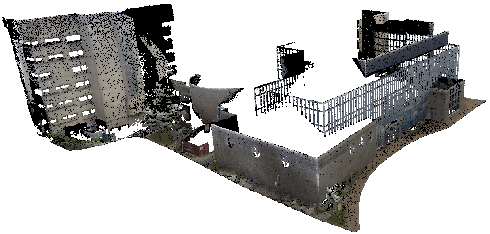
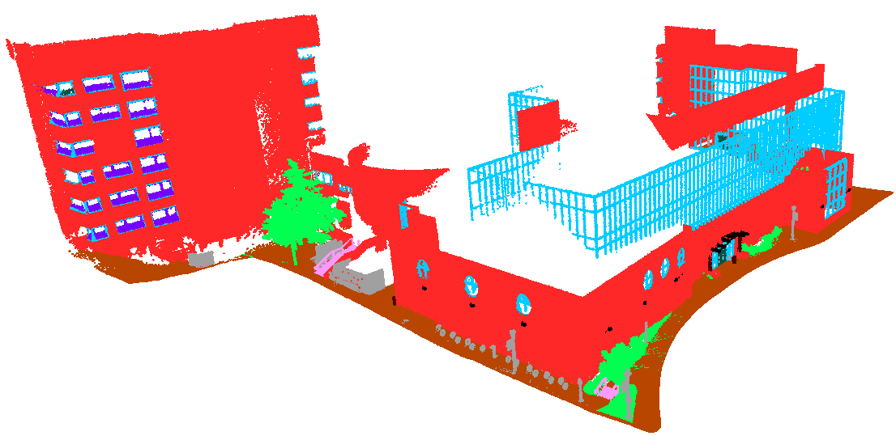

# HFX3D Benchmark

<div align="center">

Semantic segmentation benchmark for urban building facade LiDAR point clouds.<br>
**26 buildings · ~491.9 M points · 12 semantic classes · 4 seasons · 5 neighbourhoods**<br>
Halifax, Nova Scotia — ZEB Horizon handheld LiDAR

<br>




<sub>BLD022 — raw RGB point cloud (left) &nbsp;·&nbsp; ground-truth semantic labels (right)</sub>

<br>


</div>

---

## Dataset

The dataset consists of 26 Halifax, NS buildings scanned with a ZEB Horizon handheld LiDAR, split at the building level: **18 train / 4 val / 4 test**. Each building is one LAS file; each point carries 7 attributes: `[x, y, z, r, g, b, intensity]`.

| Property | Value |
|----------|-------|
| Buildings | 26 |
| Total points | ~491.9 M |
| Classes | 12 |
| Split | 18 train / 4 val / 4 test |
| Coordinates | Mean-centred per building, metric scale preserved |
| RGB | \[0, 1\] (raw 16-bit ÷ 65 535) |
| Intensity | \[0, 1\] (p1/p99 from training split) |

<br>

<div align="center">


</div>

<br>

<div align="center">


</div>

<br>

- Building index and naming → [`docs/HFX3D_README.md`](docs/HFX3D_README.md)
- 12-class taxonomy and imbalance notes → [`docs/label_taxonomy.md`](docs/label_taxonomy.md)
- Split assignments and point counts → [`data/splits/split.md`](data/splits/split.md)

---

## Walkthroughs

Full-building point cloud flythrough animations. Click **MP4** for the full-quality version.

<div align="center">
<table>
  <tr>
    <td align="center" width="50%">
      
      <br><sub><b>BLD004</b> &nbsp;·&nbsp; <a href="assets/hfx004.mp4">↓ MP4</a></sub>
    </td>
    <td align="center" width="50%">
      
      <br><sub><b>BLD010</b> &nbsp;·&nbsp; <a href="assets/hfx010.mp4">↓ MP4</a></sub>
    </td>
  </tr>
</table>
</div>

---

## Benchmark Results

**Protocol:** seed 42, 200 epochs, unweighted cross-entropy, 7-channel input (xyz+rgb+intensity), full-scene 100%-coverage inference (possibility-guided KNN-crop voting). Checkpoint selected on val set.

### Summary — Phase 1 (seed 42)

| Model | OA | mIoU | mP | mR | mF1 |
|-------|:---:|:----:|:--:|:--:|:---:|
| KPConv | 82.2% | **34.08%** | 49.7% | 42.4% | 43.2% |
| PointNet++ (SSG) | 78.5% | **29.19%** | 39.1% | 34.8% | 35.2% |
| PTv3 (Point Transformer V3) | 74.8% | **28.18%** | 45.1% | 33.7% | 35.7% |
| PointNet | 75.6% | **26.30%** | 39.8% | 32.9% | 33.3% |
| PTv2 (Point Transformer V2) | 77.9% | **20.65%** | 33.0% | 27.5% | 25.0% |
| RandLA-Net | 72.6% | **16.94%** | 24.9% | 21.4% | 21.4% |
| DGCNN | 71.9% | **15.37%** | 25.7% | 18.9% | 18.9% |

### Per-class IoU — Phase 1 (seed 42)

| Class | KPConv | PointNet++ | PTv3 | PointNet | PTv2 | RandLA-Net | DGCNN |
|-------|:------:|:----------:|:----:|:--------:|:----:|:----------:|:-----:|
| wall | 77.5% | 72.47% | 65.98% | 69.31% | **77.74%** | 67.98% | 63.53% |
| window | 28.5% | 21.99% | 6.62% | 20.45% | **29.14%** | 3.01% | 4.21% |
| door | 0.00% | 0.00% | 0.00% | **1.16%** | 0.00% | 0.00% | 0.00% |
| balcony | 19.6% | 0.00% | **36.65%** | 0.00% | 0.05% | 0.00% | 0.00% |
| vegetation | **91.2%** | 84.88% | 83.41% | 81.27% | 58.81% | 30.05% | 33.25% |
| stairs | 9.7% | **63.73%** | 0.00% | 41.14% | 0.00% | 0.00% | 0.00% |
| terrain | **87.4%** | 83.57% | 83.91% | 73.46% | 80.16% | 82.04% | 83.10% |
| roof | 6.6% | 0.02% | **22.89%** | 0.13% | 0.00% | 20.14% | 0.00% |
| blinds | **41.0%** | 6.39% | 0.00% | 4.27% | 0.00% | 0.00% | 0.00% |
| other | 23.5% | 16.25% | **28.20%** | 22.19% | 1.88% | 0.00% | 0.34% |
| column | **23.9%** | 1.02% | 10.44% | 2.20% | 0.00% | 0.00% | 0.00% |
| arch | 0.00% | 0.00% | 0.00% | 0.00% | 0.00% | 0.00% | 0.00% |
| **mIoU** | **34.08%** | **29.19%** | **28.18%** | **26.30%** | **20.65%** | **16.94%** | **15.37%** |

---

## Reproducing Results

Full setup instructions (framework cloning, file placement, cluster config) are in [`docs/reproduction.md`](docs/reproduction.md).

```bash
# Submit all seed-42 jobs at once
bash slurm/run_all_baselines.sh

# Or individually — seed123/456 variants exist for all models
sbatch slurm/kpconv/submit_kpconv_seed42.sh    # KPConv      (~24h, 200 epochs)
sbatch slurm/pointnet2/submit_pn2_seed42.sh    # PointNet++  (~24h, 64 epochs)
sbatch slurm/pointnet2/submit_pn_seed42.sh     # PointNet    (~24h, 64 epochs)
sbatch slurm/pointcept/submit_ptv2_seed42.sh   # PTv2        (~24h, 800 epochs)
sbatch slurm/pointcept/submit_ptv3_seed42.sh   # PTv3        (~24h, 800 epochs)
sbatch slurm/dgcnn/submit_dgcnn_seed42.sh      # DGCNN       (~15 min, 200 epochs)
sbatch slurm/randlanet/submit_randla_seed42.sh # RandLA-Net  (~24h, 100 epochs)
```

Set `HFX3D_DATA_ROOT` to your `HFX3D_Splits/` path before training; all dataset loaders read this env var.

### Framework Repos

| Model | Upstream |
|-------|----------|
| PTv2 / PTv3 | [Pointcept/Pointcept](https://github.com/Pointcept/Pointcept) |
| DGCNN | [AnTao97/dgcnn.pytorch](https://github.com/AnTao97/dgcnn.pytorch) |
| RandLA-Net | [QingyongHu/RandLA-Net](https://github.com/QingyongHu/RandLA-Net) |
| PointNet / PointNet++ | [yanx27/Pointnet_Pointnet2_pytorch](https://github.com/yanx27/Pointnet_Pointnet2_pytorch) |
| KPConv | [HuguesTHOMAS/KPConv-PyTorch](https://github.com/HuguesTHOMAS/KPConv-PyTorch) |

---

## Preprocessing

The distributed LAS files are already cleaned and labelled. To produce HDF5 training data:

```bash
# input_dir must contain train/ val/ test/ subdirs with .las files
python preprocessing/las_to_hdf5.py <input_dir> <output_dir>
```

`las_to_hdf5.py` is two-pass: computes intensity p1/p99 from the training split first, then normalises all splits with those stats. `preprocess.py` is included for reference if adapting to a new raw dataset.

---

## Repository Structure

```
hfx3d-benchmark/
├── assets/              # figures, walkthroughs, and other media
├── models/
│   ├── pointcept/       # HFX3DDataset class + PTv2/PTv3 configs
│   ├── dgcnn/           # training, eval, and full-scene inference scripts
│   ├── randlanet/       # dataset adapter, model, training, and eval scripts
│   ├── pointnet2/       # dataset loader + training/eval scripts (PointNet & PointNet++)
│   └── kpconv/          # dataset adapter + training/eval scripts
├── slurm/
│   ├── pointcept/       # PTv2/PTv3 SLURM scripts (seed 42/123/456)
│   ├── dgcnn/           # DGCNN SLURM scripts (seed 42/123/456)
│   ├── randlanet/       # RandLA-Net SLURM scripts (seed 42/123/456) + eval
│   ├── pointnet2/       # PointNet/PointNet++ SLURM scripts (seed 42/123/456)
│   ├── kpconv/          # KPConv SLURM scripts (seed 42/123/456)
│   ├── run_all_baselines.sh
│   └── evaluate_all_baselines.sh
├── preprocessing/
│   ├── preprocess.py    # strip label-0 points, shift labels
│   ├── las_to_hdf5.py   # LAS → HDF5 with official normalization
│   └── analyse_dataset.py
├── configs/
│   ├── palette.py       # single source of truth for all class/split colours
│   ├── label_map.json
│   └── scalar_fields.xml
├── data/splits/         # train.txt / val.txt / test.txt
└── docs/
    ├── reproduction.md
    ├── HFX3D_README.md  # building index + naming convention
    └── label_taxonomy.md
```

## Infrastructure

- **Cluster:** [Alliance Canada](https://docs.alliancecan.ca/wiki/Nibi) — `nibi.alliancecan.ca`
- **GPUs:** NVIDIA H100 80 GB · 1 GPU per job (2 for RandLA-Net)
- **Container:** Apptainer SIF (PyTorch 2.4.1, CUDA 12.1)
- **Scheduler:** SLURM

---

## Acknowledgements

<div align="center"></div>

<br>

This work was supported by the [Natural Sciences and Engineering Research Council of Canada (NSERC)](https://www.nserc-crsng.gc.ca/) and the [Canada Foundation for Innovation (CFI)](https://www.innovation.ca/). Computational resources were provided by the [Digital Research Alliance of Canada](https://alliancecan.ca/). We gratefully acknowledge [Saint Mary's University](https://www.smu.ca/) for institutional support. We thank the building owners and facility managers across Halifax for generously granting scanning access to their properties. The quality of the HFX3D annotations is owed to the dedication of our collection, curation and labelling team: Tooba Javed, Prachi Kudeshia, Jack Greenlaw, Avery Cao, and Khushal Das.

---

## License

| Component | License |
|-----------|---------|
| Dataset (point clouds + labels) | [CC BY 4.0](LICENSE-DATA) |
| Benchmark code | [MIT](LICENSE) |

---

## Contact

| | |
|--|--|
| Abdiaziz Muse | [Abdiaziz.Muse@smu.ca](mailto:Abdiaziz.Muse@smu.ca) |
| Jiju Poovvancheri | [jiju.poovvancheri@smu.ca](mailto:jiju.poovvancheri@smu.ca) |
