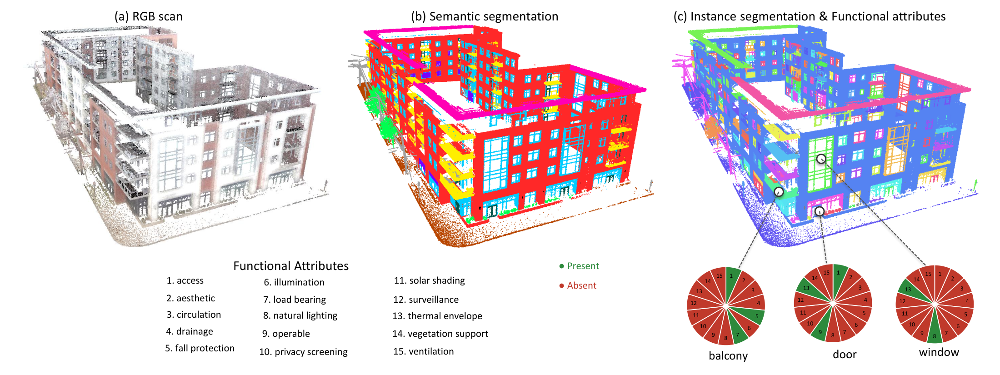
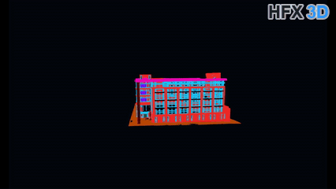
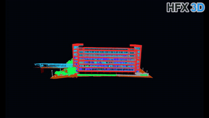
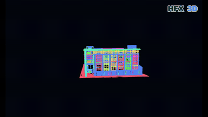
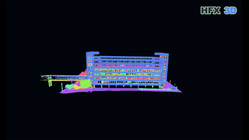
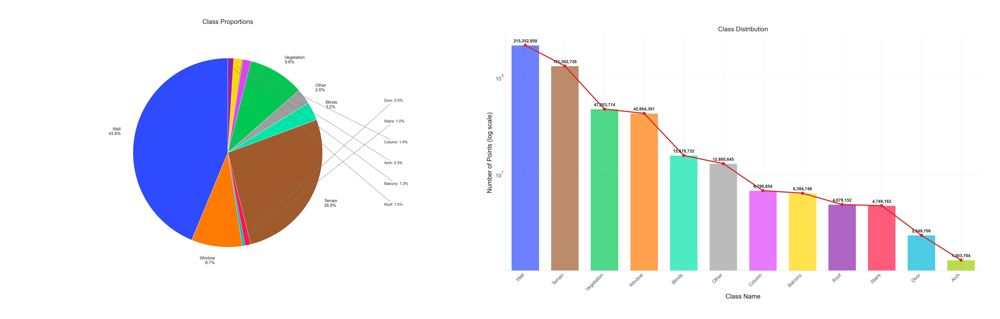
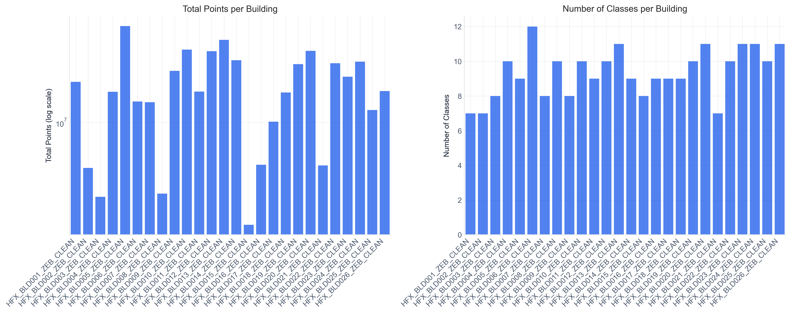
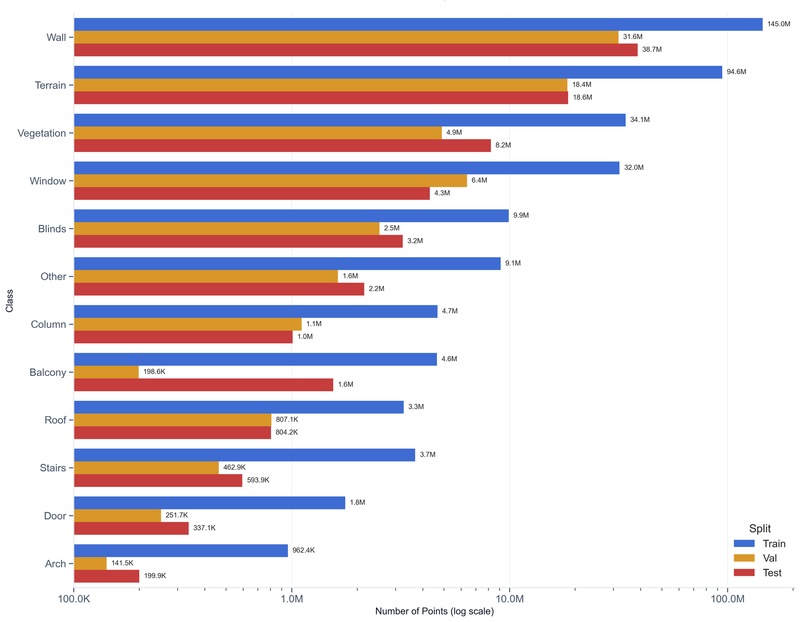
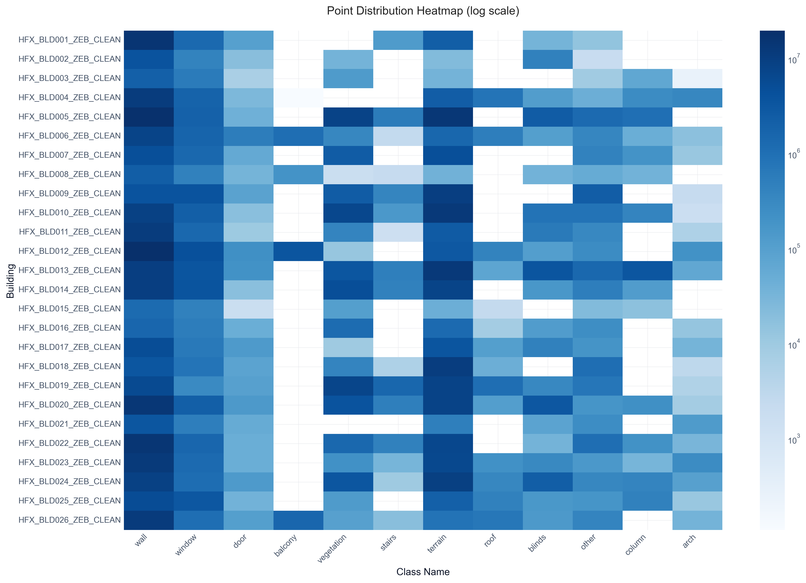

# HFX3D Benchmark

<div align="center">

### From Geometry to Function: A Multi-Task LiDAR Benchmark Dataset for Semantic and Functional Parsing of Urban Facades

**WACV 2027** · IEEE/CVF Winter Conference on Applications of Computer Vision

Abdiaziz Muse¹ · Tooba Javed¹ · Tao Pu² · Jiju Poovvancheri¹ · Dong Chen²

<sub>¹ Saint Mary's University, Halifax, Canada · ² Nanjing Forestry University, Nanjing, China</sub>

<br>

A benchmark for **semantic segmentation, instance segmentation, and functional-attribute prediction** of urban building facade LiDAR point clouds.<br>
**26 buildings · ~492 M points · 12 semantic classes · 4 seasons · 5 neighbourhoods**<br>
Halifax, Nova Scotia — ZEB Horizon handheld LiDAR

[**🌐 Project Page**](https://jijup.github.io/hfx3d-benchmark/)

<br>



<sub>From a raw RGB LiDAR scan to semantic and instance segmentation, and per-instance functional attributes</sub>

<br>


</div>

---

<div align="center">

[Dataset](#dataset) · [Download](#download) · [Tasks](#tasks) · [Benchmark](#benchmark-results) · [Reproducing](#reproducing-results) · [Annotation](#annotation-pipeline) · [Citation](#citation)

</div>

---

## Walkthroughs

Full-building point cloud fly-through animations, in **semantic** and **instance** colours. Click **MP4** for the full-quality version.

<div align="center">
<table>
  <tr>
    <td colspan="2" align="center"><sub><b>Semantic colours</b> — 12 classes as in the legend above</sub></td>
  </tr>
  <tr>
    <td align="center" width="50%">
      
      <br><sub><b>BLD004</b> &nbsp;·&nbsp; <a href="assets/hfx004.mp4">↓ MP4</a></sub>
    </td>
    <td align="center" width="50%">
      
      <br><sub><b>BLD010</b> &nbsp;·&nbsp; <a href="assets/hfx010.mp4">↓ MP4</a></sub>
    </td>
  </tr>
  <tr>
    <td colspan="2" align="center"><sub><b>Instance colours</b> — each object a distinct colour</sub></td>
  </tr>
  <tr>
    <td align="center" width="50%">
      
      <br><sub><b>BLD004</b> &nbsp;·&nbsp; <a href="assets/hfx004_instance.mp4">↓ MP4</a></sub>
    </td>
    <td align="center" width="50%">
      
      <br><sub><b>BLD010</b> &nbsp;·&nbsp; <a href="assets/hfx010_instance.mp4">↓ MP4</a></sub>
    </td>
  </tr>
</table>
</div>

---

## Dataset

The dataset consists of 26 Halifax, NS buildings scanned with a ZEB Horizon handheld LiDAR, split at the building level: **18 train / 4 val / 4 test**. Each building is one self-describing **HDF5** file carrying raw `[x, y, z, r, g, b, intensity]` plus per-point semantic and instance labels and per-instance functional attributes.

**Capture diversity:**
- **Seasons & lighting** — 6–8 months, all 4 seasons, day & night, snow/fog/sun
- **Colour** — GeoSLAM ZEB Vision (4K panoramic + dual-fisheye) fused to per-point RGB
- **Coverage** — 5 urban neighbourhoods (commercial, residential, institutional, waterfront); 2–20 floors

| Property | Value |
|----------|-------|
| Buildings | 26 (one self-describing HDF5 each) |
| Total points | ~492 M |
| Classes | 12 semantic · 15 functional attributes · 6,549 instances |
| Split | 18 train / 4 val / 4 test (343.7M / 68.4M / 79.7M pts) |
| Coordinates | `float32`, raw scanner metres (local SLAM frame) |
| RGB | `uint8`, 0–255 (raw) |
| Intensity | `uint16`, raw |

> The released HDF5 stores **raw** values. The benchmark's input protocol normalizes them at load — xyz mean-centred per building, RGB scaled to [0, 1], intensity normalized by training-split p1/p99 — to form the 7-channel model input.

<br>

<div align="center">


</div>

<br>

<div align="center">


</div>

<br>

- Building index and naming → [`docs/HFX3D_README.md`](docs/HFX3D_README.md)
- 12-class taxonomy and imbalance notes → [`docs/LABEL_TAXONOMY.md`](docs/LABEL_TAXONOMY.md)
- Split assignments and point counts → [`data/splits/SPLITS.md`](data/splits/SPLITS.md)

---

## Download

📦 The dataset is on **[Hugging Face](https://huggingface.co/datasets/SMU-GSCLab/hfx3d-benchmark)** — 26 raw per-building HDF5 files (xyz / rgb / intensity + semantic, instance, and functional labels), with a `MANIFEST.csv`, `DATASHEET.md`, and `ontology_class_to_attributes.json`. Click **Request Access** there (gated); see [Contact](#contact) with any questions.

```bash
huggingface-cli download SMU-GSCLab/hfx3d-benchmark --repo-type dataset --local-dir HFX3D_Splits
export HFX3D_DATA_ROOT=/path/to/HFX3D_Splits   # loaders normalize at load (see Dataset)
```

---

## Tasks

HFX3D targets three tasks of increasing difficulty on the same point clouds:

| Task | Description |
|------|-------------|
| **Semantic segmentation** | Per-point label over 12 facade classes |
| **Instance segmentation** | Separating discrete/repeated facade elements (e.g. individual windows) |
| **Functional-attribute prediction** | Per-instance functional attribute tagging |

Instance and functional labels are produced with the semi-automatic annotation pipeline in [`scripts/`](scripts/README.md) (geometry-based clustering + CloudCompare review).

---

## Benchmark Results

### Semantic Segmentation

**Protocol:** 200 epochs, unweighted cross-entropy, 7-channel input (xyz+rgb+intensity), full-scene 100%-coverage inference (possibility-guided KNN-crop voting). Checkpoint selected on val set.

#### Summary

| Model | OA | mIoU | mP | mR | mF1 |
|-------|:---:|:----:|:--:|:--:|:---:|
| KPConv | 86.6% | **47.26%** | 67.1% | 53.5% | 57.2% |
| PointNet++ (SSG) | 78.5% | **29.19%** | 39.1% | 34.8% | 35.2% |
| PTv3 (Point Transformer V3) | 74.8% | **28.18%** | 45.1% | 33.7% | 35.7% |
| PointNet | 75.6% | **26.30%** | 39.8% | 32.9% | 33.3% |
| PTv2 (Point Transformer V2) | 77.9% | **20.65%** | 33.0% | 27.5% | 25.0% |
| RandLA-Net | 72.6% | **16.94%** | 24.9% | 21.4% | 21.4% |
| DGCNN | 71.9% | **15.37%** | 25.7% | 18.9% | 18.9% |

#### Per-class IoU

| Class | KPConv | PointNet++ | PTv3 | PointNet | PTv2 | RandLA-Net | DGCNN |
|-------|:------:|:----------:|:----:|:--------:|:----:|:----------:|:-----:|
| wall | **80.37%** | 72.47% | 65.98% | 69.31% | 77.74% | 67.98% | 63.53% |
| window | **42.05%** | 21.99% | 6.62% | 20.45% | 29.14% | 3.01% | 4.21% |
| door | **19.47%** | 0.00% | 0.00% | 1.16% | 0.00% | 0.00% | 0.00% |
| balcony | 24.71% | 0.00% | **36.65%** | 0.00% | 0.05% | 0.00% | 0.00% |
| vegetation | **93.94%** | 84.88% | 83.41% | 81.27% | 58.81% | 30.05% | 33.25% |
| stairs | **83.43%** | 63.73% | 0.00% | 41.14% | 0.00% | 0.00% | 0.00% |
| terrain | **91.59%** | 83.57% | 83.91% | 73.46% | 80.16% | 82.04% | 83.10% |
| roof | 0.00% | 0.02% | **22.89%** | 0.13% | 0.00% | 20.14% | 0.00% |
| blinds | **42.05%** | 6.39% | 0.00% | 4.27% | 0.00% | 0.00% | 0.00% |
| other | **53.73%** | 16.25% | 28.20% | 22.19% | 1.88% | 0.00% | 0.34% |
| column | **35.80%** | 1.02% | 10.44% | 2.20% | 0.00% | 0.00% | 0.00% |
| arch | **0.01%** | 0.00% | 0.00% | 0.00% | 0.00% | 0.00% | 0.00% |
| **mIoU** | **47.26%** | **29.19%** | **28.18%** | **26.30%** | **20.65%** | **16.94%** | **15.37%** |

#### Qualitative Results

Per-building predictions vs. ground truth visualizations across all seven baseline models are on the [**project page qualitative gallery**](https://jijup.github.io/hfx3d-benchmark/#qualitative).

### Instance Segmentation

Element-level segmentation over the eight countable "thing" classes (AP averaged over IoU 0.50–0.95, plus AP50/AP25; minimum instance size 200 points). Ground-truth instance labels come from the annotation pipeline in [`scripts/`](scripts/README.md) (planar region-growing + DBSCAN, then CloudCompare review).

**Learned methods** — trained end-to-end from raw points, no semantics supplied:

| Method | mAP | AP50 | AP25 |
|--------|:---:|:----:|:----:|
| SoftGroup | **0.2032** | **0.2923** | **0.4044** |
| ISBNet | 0.0422 | 0.0883 | 0.2276 |
| PointGroup | 0.0145 | 0.0427 | 0.0955 |

**Geometry-based clustering given ground-truth semantics** — an oracle-semantic baseline that isolates instance separation once each point's class is known:

| Method | mAP | AP50 | AP25 |
|--------|:---:|:----:|:----:|
| HDBSCAN | **0.2533** | **0.3430** | **0.4521** |
| DBSCAN | 0.2063 | 0.2725 | 0.3574 |
| MeanShift | 0.0310 | 0.0871 | 0.1059 |
| KMeans | 0.0201 | 0.0615 | 0.1793 |

SoftGroup leads the learned methods at 0.29 AP50, ahead of ISBNet (0.09) and PointGroup (0.04); the difficulty is concentrated in dense, repeated elements such as windows and blinds. With ground-truth semantics supplied, HDBSCAN clustering reaches 0.34 AP50, recovering well-separated elements like balconies and columns but still merging neighbouring window panes.

### Functional-Attribute Prediction

Each instance carries a **15-dimensional multi-label functional attribute vector**. Attributes are auto-suggested from a semantic→function ontology (IFC 4.3 + Getty AAT), refined with instance geometry and graph context (log-odds fusion), then human-validated. Pipeline: [`scripts/functional_attributes/`](scripts/functional_attributes/).

**Attributes (15):** load-bearing (LB), thermal envelope (TE), access (AC), operable (OP), solar shading (SS), ventilation (VE), natural lighting (NL), drainage (DR), fall protection (FP), circulation (CI), privacy screening (PS), vegetation support (VS), aesthetic (AE), illumination (IL), surveillance (SU).

**Semantic → candidate attributes:**

| Class | Candidates | Class | Candidates |
|-------|------------|-------|------------|
| wall | LB, TE, VS | window | TE, OP, SS, VE, NL |
| roof | LB, TE, DR, FP | door | AC, OP, TE |
| column | LB, AE | blinds | SS, OP, PS |
| arch | LB, AE, IL, SU | balcony | LB, AC, VS, FP |
| terrain | CI | stairs | CI, FP |
| vegetation | AE | other | (varies) |

**Evidence ablation** — macro-F1 / exact-set-match, on all test instances and the class-ambiguous subset (S = semantic prior, G = geometry, C = context; the learned MLP row is the mean over 10 seeds):

| Evidence | mF1 (All) | ESM (All) | mF1 (Amb) | ESM (Amb) |
|----------|:---------:|:---------:|:---------:|:---------:|
| S only | 0.6367 | **0.6905** | 0.4808 | 0.5378 |
| G only | **0.8071** | 0.5880 | **0.7039** | 0.5280 |
| C only | 0.7449 | 0.5420 | 0.6746 | 0.4958 |
| S + G | 0.7458 | 0.6888 | 0.5928 | **0.5434** |
| S + C | 0.7145 | 0.6676 | 0.6072 | 0.5224 |
| S + G + C | 0.7691 | 0.6799 | 0.6606 | **0.5434** |
| Learned MLP | 0.7304 | 0.5590 | 0.6354 | 0.4141 |

Evaluated on 1,131 test instances (714 in the ambiguous subset, where semantic class alone doesn't fix the attributes — e.g. operable vs fixed windows, structural vs decorative columns).

---

## Reproducing Results

Full setup instructions (framework cloning, file placement, cluster config) are in [`docs/REPRODUCTION.md`](docs/REPRODUCTION.md).

```bash
# Submit all baseline training jobs at once
bash slurm/run_all_baselines.sh

# Or individually
sbatch slurm/kpconv/submit_kpconv.sh    # KPConv
sbatch slurm/pointnet2/submit_pn2.sh    # PointNet++
sbatch slurm/pointnet2/submit_pn.sh     # PointNet
sbatch slurm/pointcept/submit_ptv2.sh   # PTv2
sbatch slurm/pointcept/submit_ptv3.sh   # PTv3
sbatch slurm/dgcnn/submit_dgcnn.sh      # DGCNN
sbatch slurm/randlanet/submit_randla.sh # RandLA-Net
```

Set `HFX3D_DATA_ROOT` to your `HFX3D_Splits/` path before training; all dataset loaders read this env var. The scripts' `#SBATCH --account` is our Alliance allocation — you don't need it: override per job with `sbatch --account=<your-account> …`. See [Adapting to your environment](docs/REPRODUCTION.md#adapting-to-your-environment) for the full list (account, data path, container, GPUs).

### Framework Repos

| Model | Upstream |
|-------|----------|
| PTv2 / PTv3 | [Pointcept/Pointcept](https://github.com/Pointcept/Pointcept) |
| DGCNN | [AnTao97/dgcnn.pytorch](https://github.com/AnTao97/dgcnn.pytorch) |
| RandLA-Net | [QingyongHu/RandLA-Net](https://github.com/QingyongHu/RandLA-Net) |
| PointNet / PointNet++ | [yanx27/Pointnet_Pointnet2_pytorch](https://github.com/yanx27/Pointnet_Pointnet2_pytorch) |
| KPConv | [HuguesTHOMAS/KPConv-PyTorch](https://github.com/HuguesTHOMAS/KPConv-PyTorch) |

---

## Annotation Pipeline

The semi-automatic pipeline used to add **instance IDs** and to **review/correct** class labels lives in [`scripts/`](scripts/README.md). It clusters points into objects (planar region-growing + DBSCAN), exports an editable PLY for CloudCompare, and imports hand edits back into the HDF5 — the HDF5 is the source of truth, the PLY is a disposable view.

```bash
python scripts/generate_instances.py --only BLD003 --eps 0.20   # draft instances → editable PLY
python scripts/import_instances.py <edited.ply> --root Output    # pull CloudCompare edits back
python scripts/review_metrics.py --root Output                   # original-vs-reviewed report
```

Full workflow, options, and the CloudCompare guide are in [`scripts/README.md`](scripts/README.md).

### Annotation & Quality Control

- **Two-round cross-review** — one primary annotator per building; reviewers never review their own buildings; disagreements settled by majority vote.
- **Inter-annotator agreement** — Cohen's κ per building: round 1 mean **0.44** → round 2 mean **0.99** after corrections.
- **Instance refinement** — DBSCAN candidates hand-refined, **8,586 → 6,418** instances (−25.3%), mostly merging over-segmentation.

---

## Repository Structure

```
hfx3d-benchmark/
├── assets/              # figures, walkthroughs, and other media
├── models/
│   ├── pointcept/       # HFX3DDataset class + PTv2/PTv3 configs
│   ├── dgcnn/           # training, eval, and full-scene inference scripts
│   ├── randlanet/       # dataset adapter, model, training, and eval scripts
│   ├── pointnet2/       # dataset loader + training/eval scripts (PointNet & PointNet++)
│   └── kpconv/          # dataset adapter + training/eval scripts
├── slurm/
│   ├── pointcept/       # PTv2/PTv3 SLURM scripts
│   ├── dgcnn/           # DGCNN SLURM script
│   ├── randlanet/       # RandLA-Net SLURM script + eval
│   ├── pointnet2/       # PointNet/PointNet++ SLURM scripts
│   ├── kpconv/          # KPConv SLURM script
│   ├── run_all_baselines.sh
│   └── evaluate_all_baselines.sh
├── scripts/             # instance + classification annotation pipeline (see scripts/README.md)
├── configs/
│   ├── palette.py       # single source of truth for all class/split colours
│   ├── label_map.json
│   └── scalar_fields.xml
├── data/splits/         # train.txt / val.txt / test.txt
└── docs/
    ├── REPRODUCTION.md
    ├── HFX3D_README.md  # building index + naming convention
    └── LABEL_TAXONOMY.md
```

---

## Acknowledgements

<div align="center"></div>

<br>

This work was supported by the [Natural Sciences and Engineering Research Council of Canada (NSERC)](https://www.nserc-crsng.gc.ca/) and the [Canada Foundation for Innovation (CFI)](https://www.innovation.ca/). Computational resources were provided by the [Digital Research Alliance of Canada](https://alliancecan.ca/). We gratefully acknowledge [Saint Mary's University](https://www.smu.ca/) for institutional support. We thank the building owners and facility managers across Halifax for generously granting scanning access to their properties. The quality of the HFX3D annotations is owed to the dedication of our collection, curation and labelling team: Prachi Kudeshia, Jack Greenlaw, Avery Cao, Khushal Das, and Mirza Baig.

---

## Citation

If you use HFX3D in your research, please cite:

```bibtex
@inproceedings{hfx3d2027,
  title     = {From Geometry to Function: A Multi-Task {LiDAR} Benchmark Dataset
               for Semantic and Functional Parsing of Urban Facades},
  author    = {Muse, Abdiaziz and Javed, Tooba and Pu, Tao and
               Poovvancheri, Jiju and Chen, Dong},
  booktitle = {Proceedings of the IEEE/CVF Winter Conference on Applications
               of Computer Vision (WACV)},
  year      = {2027},
}
```

---

## License

| Component | License |
|-----------|---------|
| Dataset (point clouds + labels) | [CC BY 4.0](LICENSE-DATA) |
| Benchmark code | [MIT](LICENSE) |

---

## Contact

| | |
|--|--|
| Abdiaziz Muse | [Abdiaziz.Muse@smu.ca](mailto:Abdiaziz.Muse@smu.ca) |
| Jiju Poovvancheri | [jiju.poovvancheri@smu.ca](mailto:jiju.poovvancheri@smu.ca) |
